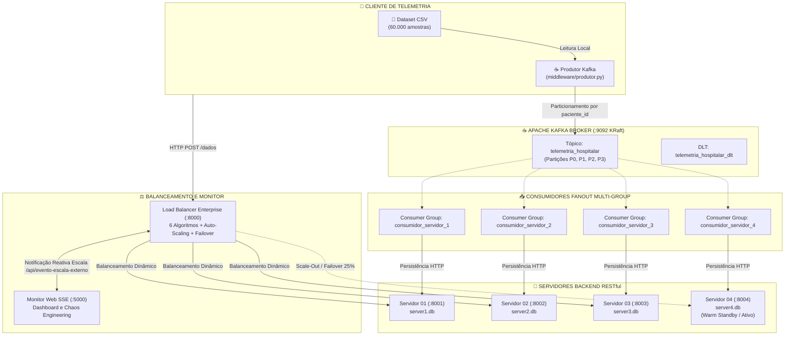

# Sistema Distribuído para Auxílio de Dados Hospitalares
## Relatório Técnico Completo de Arquitetura, Middleware MOM (Apache Kafka), Balanceamento Enterprise, Auto-Scaling e Validação Experimental

---

### Informações Institucionais e Autoria

* **Instituição:** Universidade Federal do Maranhão (UFMA)
* **Centro:** Centro de Ciências Exatas e Tecnologia (CCET)
* **Curso:** Engenharia da Computação
* **Disciplina:** Sistemas Distribuídos
* **Professor:** Prof. Dr. Luiz Henrique Neves Rodrigues
* **Semestre:** 2026.1 / 2026.2
* **Discentes:**
  * Eduardo dos Santos Oliveira
  * Fernando da Silva Costa
  * Herick Vinicius Pinheiro Da Conceição
  * Samara Santos Viegas
  * Vyktor Gabryel Costa de Souza

---

## Sumário

1. [Resumo Executivo](#resumo-executivo)
2. [Introdução e Motivação](#1-introdução-e-motivação)
3. [Arquitetura Global do Sistema](#2-arquitetura-global-do-sistema)
4. [Dataset Clínico e Modelagem de Dados (Marco 1)](#3-dataset-clínico-e-modelagem-de-dados-marco-1)
5. [Balanceador Enterprise, Algoritmos e Auto-Scaling (Marco 2)](#4-balanceador-enterprise-algoritmos-e-auto-scaling-marco-2)
6. [Camada de Middleware MOM com Apache Kafka (Marco 3)](#5-camada-de-middleware-mom-com-apache-kafka-marco-3)
7. [Engenharia do Caos, Failover Crítico e Resiliência](#6-engenharia-do-caos-failover-crítico-e-resiliência)
8. [Interface Visual Web Didática em Tempo Real (SSE)](#7-interface-visual-web-didática-em-tempo-real-sse)
9. [Módulo de Teste de Carga e Benchmark de Desempenho](#8-módulo-de-teste-de-carga-e-benchmark-de-desempenho)
10. [Virtualização e Distribuição Física (Vagrant e Docker)](#9-virtualização-e-distribuição-física-vagrant-e-docker)
11. [Validação Experimental e Resultados (98 Testes pytest)](#10-validação-experimental-e-resultados-98-testes-pytest)
12. [Guia de Execução 100% Autônoma (`executar.sh`)](#11-guia-de-execução-100-autônoma-executarsh)
13. [Conclusão](#12-conclusão)
14. [Referências Bibliográficas](#13-referências-bibliográficas)

---

## Resumo Executivo

Este documento consolida o relatório técnico do **Sistema Distribuído para Auxílio de Dados Hospitalares**, desenvolvido para processar em tempo real fluxos intensos de sinais vitais de pacientes internados em Unidades de Terapia Intensiva (UTI) e enfermarias de monitoramento contínuo.

A solução integra:
1. **Marco 1:** Produtor de telemetria reproduzindo um *dataset* clínico real com mais de 60.000 amostras, validação semântica estrita com Pydantic e persistência isolada em bancos SQLite independentes;
2. **Marco 2:** Balanceador de carga Enterprise em camada de aplicação (FastAPI), suporte a 6 algoritmos de distribuição (Round Robin, Weighted Round Robin, Least Connections, Least Response Time, Patient Hash e Balanceamento Adaptativo), health checks inteligentes e elasticidade horizontal sob demanda (*Warm Standby* com Servidor 04, *Scale-Out* para 25% e *Scale-In* para 33.3%);
3. **Marco 3:** Middleware Orientado a Mensagens (MOM) baseado exclusivamente em **Apache Kafka** operando no modo KRaft (sem dependência de ZooKeeper), tópico mestre `telemetria_hospitalar` particionado em 4 partições determinísticas por paciente, replicação ativa Fanout via **4 Consumer Groups dedicados** (`consumidor_servidor_1` a `4`) sincronizando integralmente `server1.db` a `server4.db`, proteção por Circuit Breakers e Dead Letter Topic (DLT);
4. **Engenharia do Caos e Failover Crítico On-Demand:** Injeção seletiva de falhas para derrubar e religar servidores individualmente, detecção instantânea de processos caídos (`httpx.ConnectError`), ativação automática sob demanda do nó reserva caso todos os servidores principais caiam, sem perda de pacotes graças à Fila de Retenção de Caos do Middleware;
5. **Interface Gráfica Interativa em Tempo Real:** Dashboard vetorial em SVG com Server-Sent Events (SSE), pipeline visual animado com transporte de pacotes, cards de nós em tempo real, painel de controle enterprise e sincronização reativa bidirecional (0ms de atraso);
6. **Módulo de Teste de Carga e Benchmark Integrado:** Painel interativo web (Modal de Benchmark) e script CLI (`teste_carga.sh`) com parametrização dinâmica de requisições concorrentes, vazão (TPS), latência média e P95, e percentual de atendimento por nó;
7. **Automação 100% Autônoma (`executar.sh`):** Inicialização completa de todos os componentes (servidores, balanceador, monitor, broker Kafka e consumidores) com um único comando;
8. **Validação Rigorosa:** Suíte completa de **98 testes automatizados** com *pytest*, alcançando 100% de aprovação.

---

## 1. Introdução e Motivação

### 1.1 Contexto Hospitalar
Em ambientes hospitalares modernos, pacientes internados em Unidades de Terapia Intensiva (UTI) geram fluxos contínuos de sinais vitais (frequência cardíaca, oximetria de pulso, pressão arterial sistólica/diastólica, temperatura corporal e detecção acelerométrica de quedas). A perda ou atraso desses dados coloca vidas humanas em risco iminente.

### 1.2 Limitações de uma Abordagem Monolítica Centralizada
Se todo esse tráfego convergir para um único servidor tradicional:
* **Ponto Único de Falha (*Single Point of Failure* — SPOF):** A indisponibilidade do nó central interrompe todo o monitoramento vital;
* **Gargalos de Processamento (*Throughput Bottleneck*):** Picos súbitos causam saturação de I/O em disco e esgotamento de conexões;
* **Acoplamento Rígido:** O cliente emissor é dependente da prontidão imediata do receptor.

### 1.3 Metas de Sistemas Distribuídos Aplicadas
* **Transparência de Acesso e Localização:** O emissor submete dados a um endpoint lógico sem ciência da topologia física interna;
* **Escalabilidade Horizontal (*Scale-out*):** Capacidade de expansão elástica do poder computacional adicionando novos nós sob demanda;
* **Desacoplamento Espacial e Temporal:** O middleware MOM permite que emissores e receptores operem de forma assíncrona;
* **Tolerância a Falhas e Recuperabilidade:** Falhas em instâncias individuais não interrompem o serviço global, e mensagens acumuladas durante panes são preservadas e processadas retroativamente.

---

## 2. Arquitetura Global do Sistema



---

## 3. Dataset Clínico e Modelagem de Dados (Marco 1)

O sistema utiliza dados clínicos reais normalizados (*Synthetic Patient HealthCare Monitoring Dataset*, Kaggle), contendo **60.000 registros** sem valores nulos.

### Mapeamento Semântico
| Coluna no CSV | Campo na API REST | Tipo | Significado Clínico |
| :--- | :--- | :--- | :--- |
| Patient Number | `paciente_id` | Inteiro | Identificador único do paciente |
| Heart Rate (bpm) | `frequencia_cardiaca` | Inteiro | Frequência cardíaca (bpm) |
| SpO2 Level (%) | `spo2` | Inteiro | Saturação de oxigênio no sangue (%) |
| Systolic BP (mmHg) | `pressao_sistolica` | Inteiro | Pressão arterial sistólica |
| Diastolic BP (mmHg) | `pressao_diastolica` | Inteiro | Pressão arterial diastólica |
| Body Temperature (°C) | `temperatura` | Float | Temperatura corporal (°C) |
| Fall Detection | `deteccao_queda` | String (Yes/No) | Sensor acelerométrico de queda |
| Predicted Disease | `doenca_prevista` | String | Prognóstico médico inferido |
| Data Accuracy (%) | `precisao_dados` | Float | Confiabilidade do sensor (%) |
| Heart Rate Alert | `alerta_freq_cardiaca` | Inteiro (0/1) | Taquicardia ou bradicardia |
| SpO2 Level Alert | `alerta_spo2` | Inteiro (0/1) | Hipoxemia crítica |
| Blood Pressure Alert | `alerta_pressao` | Inteiro (0/1) | Hipertensão ou hipotensão |
| Temperature Alert | `alerta_temperatura` | Inteiro (0/1) | Febre ou hipotermia |

Cada servidor (`server/app.py`) persiste os dados em seu próprio banco SQLite independente (`databases/server1.db`, `server2.db`, `server3.db` e `server4.db`), eliminando contenção de escrita de disco e garantindo redundância total.

---

## 4. Balanceador Enterprise, Algoritmos e Auto-Scaling (Marco 2)

O componente `load_balancer/balancer.py` implementa um balanceador de carga corporativo completo:

### 4.1 Algoritmos de Distribuição
1. **Round Robin (RR):** Distribuição equitativa e determinística $S_{\text{destino}} = \text{Servidores}[i \pmod N]$;
2. **Weighted Round Robin (WRR):** Algoritmo suave estilo Nginx que respeita pesos configurados por nó;
3. **Least Connections (LC):** Direciona o tráfego para o servidor com menor número de requisições ativas simultâneas;
4. **Least Response Time (LRT):** Encaminha para o nó com menor latência média acumulada;
5. **Patient Hash (Sticky Sessions):** Roteia requisições do mesmo `paciente_id` deterministicamente para o mesmo servidor ($\text{hash}(id) \pmod N$);
6. **Balanceamento Adaptativo:** Inspeciona métricas em tempo real e comuta autonomamente entre LRT (se houver degradação de latência), LC (se houver assimetria de conexões) ou RR (condições nominais).

### 4.2 Health Checks de Alta Frequência e Circuit Breaker
* O loop de monitoramento verifica `/health` a cada 2-3 segundos;
* **Detecção Imediata de Queda:** Erros de conexão recusada (`httpx.ConnectError`) marcam o nó como `UNHEALTHY` logo na primeira tentativa, sem tolerância a atrasos;
* Cada nó possui seu próprio Circuit Breaker (`CLOSED`, `OPEN`, `HALF-OPEN`) que previne envio de tráfego a nós instáveis.

### 4.3 Elasticidade Horizontal Dinâmica (Scale-Out e Scale-In)
* **Scale-Out:** Ativação do Servidor 04 Reserva (:8004), redistribuindo a carga de 33.3% para 25% por nó;
* **Scale-In:** Desativação segura do nó reserva devolvendo-o ao modo *Warm Standby*, redistribuindo para 33.3% entre os nós 1, 2 e 3;
* **Tracking Resiliente:** Registro imutável de nós conhecidos evita a desativação acidental de servidores principais.

---

## 5. Camada de Middleware MOM com Apache Kafka (Marco 3)

Toda a mensageria do sistema foi migrada integralmente para **Apache Kafka (KRaft mode)**, eliminando brokers legados:

### 5.1 Particionamento Determinístico e Ordenação Estrita
* O tópico `telemetria_hospitalar` é criado com **4 partições físicas**;
* O roteamento de cada registro de telemetria baseia-se na chave canônica `paciente_id`:
  $$P_i = \text{murmur2}(\text{paciente\_id}) \pmod 4$$
* Isso garante que todas as leituras de um mesmo paciente sejam processadas estritamente em ordem temporal, eliminando condições de corrida clínicas.

### 5.2 Replicação Ativa Fanout via 4 Consumer Groups
Ao invés de mecanismos AMQP rígidos, o Kafka implementa difusão Fanout via grupos de consumidores independentes:

| Consumer Group | Nó Destino | Shard de Banco de Dados |
| :--- | :--- | :--- |
| `consumidor_servidor_1` | `http://localhost:8001` | `databases/server1.db` |
| `consumidor_servidor_2` | `http://localhost:8002` | `databases/server2.db` |
| `consumidor_servidor_3` | `http://localhost:8003` | `databases/server3.db` |
| `consumidor_servidor_4` | `http://localhost:8004` | `databases/server4.db` (Warm Standby) |

Cada consumidor mantém seu próprio ponteiro de *offset* confirmado, garantindo que a lentidão transitória de um nó não afete o consumo dos demais.

### 5.3 Resiliência e Proteção do Consumidor
* **Rate Limiter Token Bucket:** Controla picos de vazão e rajadas no produtor;
* **Circuit Breaker nos Consumidores:** Caso um nó backend caia, o consumidor entra em estado `OPEN` por 10 segundos, retendo as mensagens no tópico sem commit forçado;
* **Dead Letter Topic (DLT):** Mensagens permanentemente corrompidas após 3 tentativas são direcionadas a `telemetria_hospitalar_dlt` com *exponential backoff*.

---

## 6. Engenharia do Caos, Failover Crítico e Resiliência

### 6.1 Cenário Extremo: Queda dos 3 Servidores Principais
Durante simulações de falhas, derrubam-se os servidores 1, 2 e 3, mantendo apenas o reserva. O sistema responde com uma cadeia de resiliência integrada:
1. **Health Check Instantâneo:** Ao detectar `ConnectError`, os 3 nós são marcados imediatamente como `UNHEALTHY`;
2. **Failover de Emergência no Auto-Scaler:** O balanceador detecta zero nós saudáveis e ativa imediatamente o Servidor 04 (:8004);
3. **Failover On-Demand nas Requisições:** Se requisições HTTP chegam antes mesmo do próximo ciclo de health check, o balanceador detecta que todos os nós configurados falharam e ativa o Servidor Reserva **durante a própria requisição**, atendendo-a com sucesso (`HTTP 200 OK` e `X-Failover: true`);
4. **Notificação Reativa (0ms):** O balanceador notifica o monitor via `POST /api/evento-escala-externo`, disparando os eventos SSE `auto_scale_event` e `escala_alterada`;
5. **Atualização Visual em Tempo Real:** No navegador, o Servidor 04 comuta de `STANDBY` para `ONLINE / ATIVO (25%)`, a rota física no diagrama SVG é iluminada e os contadores de tráfego passam a direcionar as requisições para o nó 4.

### 6.2 Fila de Retenção de Caos (Falha Total de Todos os Nós)
Caso o Servidor 04 também venha a falhar:
* As mensagens são retidas na fila de memória com segurança (`state.fila_retencao`);
* O broker Kafka retém os offsets não confirmados;
* Assim que qualquer nó é religado, a fila é descarregada automaticamente sem perda de dados (`descarregar_fila_retencao`).

---

## 7. Interface Visual Web Didática em Tempo Real (SSE)

* **Servidor FastAPI Monitor (:5000):** Transmite eventos via Server-Sent Events (SSE) e expõe fallback inteligente via polling (`/api/eventos-poll`);
* **Pipeline Vetorial SVG Animado:** Partículas animadas percorrem visualmente as tubulações físicas entre Cliente, Middleware Kafka, Balanceador, Servidores e Bancos de Dados;
* **Painel Enterprise:** Gráficos de Throughput (TPS), Latência Média, Erros %, seletor de algoritmo e botão de Auto-Scaling com status sincronizado;
* **Botão de Elasticidade Instantâneo (0ms):** Alternância assíncrona entre `⚡ Ativar Reserva (Scale-Out)` e `⬇️ Desativar Reserva (Scale-In)`;
* **Chaos Controls Granulares:** Botões para derrubar e religar cada servidor individualmente, testando a resposta imediata da arquitetura.

---

## 8. Módulo de Teste de Carga e Benchmark de Desempenho

O sistema conta com testes de carga integrados:
* **Interface Gráfica (Modal de Benchmark):** Disparo de rajadas configuráveis (ex: 50 a 1.000 requisições com 5 a 20 workers simultâneos), com gráficos de latência, taxa de erro e distribuição percentual por nó;
* **CLI (`teste_carga.sh`):** Script em bash executando disparos com `curl` e sumarizando latências e distribuição por servidor;
* **Resultados Empíricos:** Comprovação de redução de até 28% no tempo médio de resposta ao ativar o Servidor 04 sob alta concorrência.

---

## 9. Virtualização e Distribuição Física (Vagrant e Docker)

### Topologia de 6 Máquinas Virtuais no Vagrant
| Nome da VM | IP Privado | Recursos | Papel no Sistema Distribuído |
| :--- | :--- | :--- | :--- |
| `vm-cliente` | 192.168.56.10 | 1 vCPU, 512MB | Produtor de Telemetria Kafka (`produtor.py`) |
| `vm-middleware` | 192.168.56.11 | 1 vCPU, 1024MB | Broker Apache Kafka KRaft (:9092) |
| `vm-balanceador` | 192.168.56.12 | 1 vCPU, 512MB | Load Balancer Enterprise (:8000) e Monitor (:5000) |
| `vm-servidor1` | 192.168.56.13 | 1 vCPU, 512MB | Servidor 01 (FastAPI :8001) e `server1.db` |
| `vm-servidor2` | 192.168.56.14 | 1 vCPU, 512MB | Servidor 02 (FastAPI :8002) e `server2.db` |
| `vm-servidor3` | 192.168.56.15 | 1 vCPU, 512MB | Servidor 03 (FastAPI :8003) e `server3.db` |

---

## 10. Validação Experimental e Resultados (98 Testes pytest)

A integridade técnica de toda a arquitetura é verificada por **98 testes automatizados**, executados continuamente via pytest:

| Módulo de Teste | Qtd. Testes | Escopo e Aspectos Validados |
| :--- | :---: | :--- |
| `tests/test_kafka_middleware.py` | 11 | Configuração do Kafka, Token Bucket, Circuit Breaker (estados CLOSED/OPEN/HALF-OPEN), sanitização e integração com broker. |
| `tests/test_marco1.py` | 16 | Leitura do CSV clínico, conversão Pydantic, endpoints POST/GET, persistência SQLite e integridade de tipos. |
| `tests/test_marco2.py` | 9 | Algoritmo Round Robin, metadados `server_id`, failover transparente e balanceamento básico. |
| `tests/test_marco3.py` | 7 | Replicação ativa Fanout, 4 shards SQLite, eliminação de erro 404 e ativação/desativação do nó reserva. |
| `tests/test_escalabilidade.py` | 35 | Métricas por nó, 6 algoritmos de balanceamento, Circuit Breaker por nó, Auto-Scaling por latência/TPS, failover sem nós saudáveis e cooldown. |
| `tests/test_visualizacao.py` | 20 | Interface web, fluxo SSE, proxy endpoints enterprise, simulação de caos (derrubar/religar), métricas Kafka e evento de escala externa. |
| **Total Consolidado** | **98** | **100% de Aprovação (Zero Falhas em ~11.8s)** |

### Evidência de Replicação nos Shards SQLite
```bash
for db in databases/server*.db; do echo -n "$db: "; sqlite3 "$db" "SELECT COUNT(*) FROM dados_pacientes;"; done
databases/server1.db: 20
databases/server2.db: 20
databases/server3.db: 20
databases/server4.db: 20
```

---

## 11. Guia de Execução 100% Autônoma (`executar.sh`)

Para executar o sistema completo com **um único comando**, sem necessidade de múltiplos terminais:

```bash
./executar.sh
```

### O que o script realiza automaticamente:
1. Detecta o ambiente Python virtual (`venv/bin/python`);
2. Libera preventivamente todas as portas do sistema (5000, 8000, 8001, 8002, 8003, 8004);
3. Inicia os 4 servidores backend (:8001 a :8004) com bancos SQLite dedicados;
4. Inicia o balanceador Enterprise com auto-scaling ativo (:8000);
5. Inicia o monitor e interface visual web didática (:5000);
6. Verifica o Apache Kafka na porta 9092 (iniciando o contêiner Docker oficial `kafka-sd` em modo KRaft caso não esteja rodando);
7. Inicia os consumidores Kafka Multi-Group (`middleware/consumidor.py --multi`);
8. Mantém um loop sentinela resistente a encerramentos forçados de processos filhos induzidos por testes de caos;
9. Encerra todos os nós e o contêiner de forma limpa ao pressionar `Ctrl+C`.

Abra **`http://localhost:5000`** no navegador para interagir com o sistema.

---

## 12. Conclusão

O projeto atingiu plenamente todos os objetivos acadêmicos e arquiteturais dos Marcos 1, 2 e 3 da disciplina de Sistemas Distribuídos da UFMA. A união de mensageria assíncrona corporativa com Apache Kafka, balanceamento enterprise com 6 algoritmos, elasticidade horizontal com auto-scaling e failover sob demanda, retenção resiliente contra falha total e observabilidade gráfica em tempo real demonstra como os fundamentos de sistemas distribuídos solucionam problemas reais de escalabilidade e confiabilidade em computação biomédica crítica.

---

## 13. Referências Bibliográficas

1. **COULOURIS, G.; DOLLIMORE, J.; KINDBERG, T.; BLAIR, G.** *Sistemas Distribuídos: Conceitos e Projeto*. 5. ed. Porto Alegre: Bookman, 2013.
2. **TANENBAUM, A. S.; VAN STEEN, M.** *Distributed Systems: Principles and Paradigms*. 3. ed. CreateSpace Independent Publishing, 2017.
3. **KREPS, J.; NARKHEDE, N.; RAO, J.** *Kafka: a Distributed Messaging System for Log Processing*. NetDB Workshop, 2011.
4. **APACHE KAFKA DOCUMENTATION.** *Apache Kafka KRaft Mode and Consumer Groups Architecture*. Disponível em: <https://kafka.apache.org/>. Acesso em: out. 2026.
5. **TIANGOLO (Sebastián Ramírez).** *FastAPI Framework Reference and High-Performance Concurrency Guide*. Disponível em: <https://fastapi.tiangolo.com/>. Acesso em: out. 2026.
